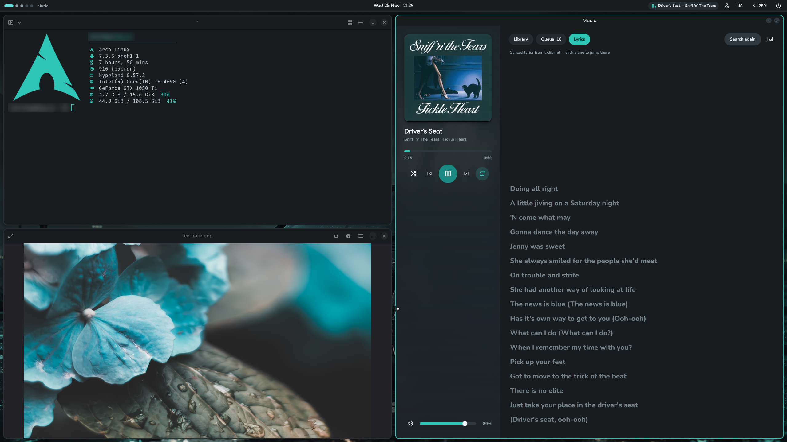

# Teerquaz

A flat, slate-turquoise desktop for **Hyprland 0.57** (Lua config) with a shell written in **Quickshell**:
bar, quick settings, notifications, overview, a Settings app, lock screen and a music player with synced lyrics.
It is laid out to feel like GNOME: floating windows by default, tiling per workspace, a hot corner and an overview.



## What's in it

**Shell** (`.config/quickshell`)
- **Bar**: workspaces, active window title, clock with notification dot, the song that's playing (scrolls while it plays), tray, network, keyboard layout, volume, battery on laptops
- **Quick settings**: volume and brightness sliders, output picker, Wi-Fi, Bluetooth, night light, screen recording, keep awake, do not disturb, media card
- **Notifications** with popups, history in the calendar panel and per-app rules
- **Overview** (tap Super) with live workspaces and app search, **Alt+Tab** switcher, app grid
- **Settings** window: appearance, fonts, displays, windows, sound, keyboard & mouse, shortcuts, notifications, power & idle, network, default apps, date & time
- **Lock screen** with PAM, keyboard layout and Caps Lock hints, and a now-playing card with the current lyric line
- **Music** player for your Music folder: library, queue, search, shuffle and repeat, synced lyrics from [LRCLIB](https://lrclib.net) (or a `.lrc` file next to the song), a mini player when the window floats, and a drop-down mini player from the bar's song pill
- Polkit agent, clipboard history, screenshots, screen recording, USB drive mounting and eject, idle lock and suspend, OSD for volume and brightness

**Hyprland** (`.config/hypr`): Lua config split into colours, window behaviour, input and monitors (the last three are rewritten by the Settings app), GNOME-like floating/tiling logic, hyprbars title bars, and a small plugin (`plugins/shell-bridge`) that sends apps' minimise and window-menu requests to the shell.

**Apps**: Ghostty, fuzzel, zathura, fastfetch, GTK 3/4 + libadwaita colours, and a Kvantum theme for Qt apps.

**Wallpaper**: `wallpapers/teerquaz.png` (2560×1440).

## Palette

| Role | Colour |
|---|---|
| Background | `#181c1f` · `#1e2327` · `#242b30` · `#2f383e` · `#3e4a51` |
| Text | `#f0f4f6` · `#dce4e8` · `#8b9aa2` |
| Focus / selection | `#64dfdf` |
| Accent (switched on) | `#2ec4b6` · `#1b8a84` |
| Warning / danger | `#e9c46a` · `#e76f51` |

## Requirements

Arch Linux packages (names may differ elsewhere):

- `hyprland` 0.57+, `hyprland-plugin-hyprbars`, `quickshell` 0.3+
- `pipewire` `wireplumber` `networkmanager` `upower` `udisks2` `bluez`
- `ghostty` `fuzzel` `thunar` `zathura` `fastfetch` `kvantum`
- `mpv` `mpv-mpris` `ffmpeg` `python` `playerctl` (music player, media keys)
- `grim` `slurp` `wl-clipboard` `cliphist` `libnotify` `brightnessctl` `hyprsunset` `gpu-screen-recorder` (optional: `satty` for editing screenshots)
- Fonts: **Nunito**, **Comfortaa**, **Material Symbols Rounded**, **Maple Mono NF** (terminal)

## Install

Back up your own configs first; these files replace them.

```bash
git clone https://github.com/boubounokefalos/teerquaz-dotfiles && cd teerquaz-dotfiles
cp -r .config/* ~/.config/
cp .local/share/applications/*.desktop ~/.local/share/applications/
mkdir -p ~/Pictures/Wallpapers && cp wallpapers/teerquaz.png ~/Pictures/Wallpapers/
```

Build the title-bar plugin (again after every Hyprland update):

```bash
make -C ~/.config/hypr/plugins/shell-bridge
```

Then log in to Hyprland. `monitors.lua` and `input.lua` are plain defaults: set your screens and keyboard
from **Settings → Displays** and **Settings → Keyboard & mouse**.

Handy commands:

```bash
qs ipc call settings open        # Settings window
qs ipc call music open           # Music player (also in the app grid)
qs ipc call music drop           # drop-down mini player
```

## Notes

- Made for one NVIDIA desktop and one Intel laptop; hardware bits (battery, brightness, Wi-Fi, NVIDIA env) switch on only where they exist.
- The music player sends only artist, title, album and length to lrclib.net when a song has no local lyrics; results are cached in `~/.cache/qs-music`.

## License

MIT, see [LICENSE](LICENSE).
